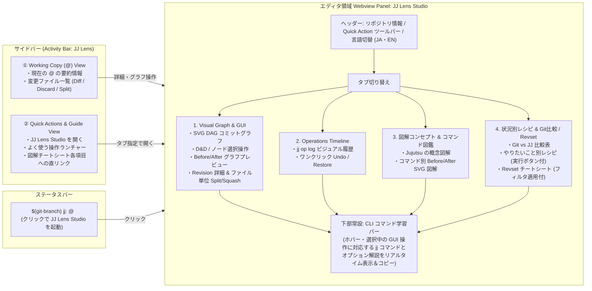

# JJ Lens 拡張機能 設計・実装計画書

## 1. 背景と目的

現在の `jj-lens` は VS Code 標準の `TreeView` を用いて `jj log` と `jj op log` をフラットに表示しているが、以下の課題がある。

- **既存の TreeView が見づらい**: コミットの親子関係（枝分かれ・マージ）が視覚的にわからず、リビジョンと変更ファイルが同じ階層ツリーに混在し、Change ID の最短ユニークプレフィックス強調や色付きバッジもない。
- **Jujutsu 特有のメンタルモデルやコマンドが直感的に理解しにくい**: Git との違い（Working Copy 自体がコミット `@` である点、Change ID と Commit ID の違い、匿名ブランチと Bookmark、`rebase -r/-s/-b` や `squash` の挙動など）を図解で理解しながら操作できる仕組みがない。
- **GUI 操作の幅とフィードバックの不足**: ファイル単位の `split` / `squash`、複数親を指定したマージ作成、`absorb`、`parallelize`、`evolog` などを視覚的なプレビュー付きで安全に実行したい。

これらを解決するため、**「見やすいサイドバー構成への刷新」**と、エディタ領域で開く統合 Webview パネル **「JJ Lens Studio（ビジュアルグラフ＆GUI操作＋図解コマンド図鑑＋Git比較・状況別チートシート）」** を構築する。

---

## 2. UI / UX 全体アーキテクチャ



### 2.1 サイドバーの2セクション構成（既存 TreeView の刷新）

見づらかったフラットな履歴ツリーをサイドバーから外し、サイドバーは以下の2つの役割に集中させる。

1. **`Working Copy (@)` ビュー (`jj-lens.workingCopy`)**
   - 現在の作業コピー（`@`）の Change ID（最短プレフィックス情報付き）・説明文・Bookmark・コンフリクト状態を表示。
   - `@` に含まれる変更ファイル一覧（`M` / `A` / `D` / `R` / `C`）のみをシンプルに表示し、クリックで編集可能な Diff を開く。
   - インラインアクションとして「ファイルを開く」「このファイルの変更を破棄（`jj restore`）」「説明を編集（`jj describe`）」「確定して次へ（`jj commit`）」を提供。
2. **`Quick Actions & Guide` ビュー (`jj-lens.guide`)**
   - **「JJ Lens Studio（ビジュアルグラフ & GUI）を開く」** メインエントリ。
   - **クイック操作**: `New Change (@の上に新規作成)`, `Commit (@を確定して新規作成)`, `Describe`, `Squash into Parent`, `Absorb`, `Undo Last Operation`, `Git Fetch`, `Git Push`。
   - **図解ガイド＆チートシート直リンク**: クリックするとエディタ領域の `JJ Lens Studio` が該当タブ・該当セクションにフォーカスした状態で開く（Git比較表、コマンド図鑑、状況別レシピ、Revsetチートシート、Operation Timeline）。

### 2.2 ステータスバー連携

- VS Code 左下のステータスバーに現在の `@` の状態（例: `jj: @ rsnlszuy "feat: ..."`）を表示し、クリックで即座に `JJ Lens Studio` を開けるようにする。

### 2.3 表示言語の切り替え（日本語 / 英語）

- Webview パネル右上のトグル（または VS Code の表示言語設定 `vscode.env.language` との連動、デフォルトは日本語 `ja`）で、図解・チートシート・GUI ラベル・CLI 解説を **日本語 / 英語** にワンクリックで切り替え可能にする。

---

## 3. エディタ領域 `JJ Lens Studio` の各タブ詳細設計

### 3.1 タブ1: Visual Graph & GUI（ビジュアルコミットグラフ & GUI 操作）

#### (1) SVG コミットグラフ（DAG）描画

- **視覚的要素**:
  - 親子・分岐・マージを繋ぐカラーの SVG 曲線レーン。
  - ノード種別の明確な視覚化：`@`（現在の Working Copy：緑リング強調）、Immutable（ロックアイコン）、Conflict（赤警告バッジ）、Empty（破線ノード）。
  - **Jujutsu スタイルの Change ID 表示**: `changePrefix`（最短ユニークプレフィックス）をアクセントカラー＋太字で強調し、残りの文字を薄く表示。
  - **色付きピルバッジ**: ローカル Bookmark、リモート Bookmark（`origin` 等）、Tag を色分けされたバッジで表示。
- **Revset フィルタバー**:
  - 任意の Revset 式入力に加え、`Default`, `trunk()..@`, `mine()`, `all()`, `conflicts()`, `mutable()` のワンクリックチップを配置。

#### (2) ドラッグ＆ドロップ / ノード選択と「実行前 Before/After プレビュー」

- グラフ上のノードを別のノードへドラッグ＆ドロップ（または2ノード選択）した際、操作メニューを表示：
  - **Rebase**:
    - `-s`（このリビジョンと子孫すべてを移動）
    - `-r`（このリビジョン単体のみを抜いて移動、子孫は親へ繋ぎ直し）
    - `-b`（ブランチ全体を移動）
  - **Squash**: `--from <source> --into <target>`（変更を任意のリビジョンへ統合）
  - **New Merge Commit**: 複数ノードを親にして `jj new <revA> <revB>` でマージコミットを作成
  - **Parallelize**: 連続する直列コミットを並列の兄弟コミットに変換（`jj parallelize <revA>::<revB>`）
- **Before / After プレビューモーダル**:
  - 実行ボタンを押す前に、**「現在のグラフ（Before）」と「操作後の予測グラフ（After）」を SVG で並べて図示**し、さらに実行される正確な `jj` コマンドを表示して安全に確定できる。

#### (3) 右ペイン：リビジョン詳細インスペクタ & ファイル単位操作

- **Description エディタ**: 複数行のコミット説明文をそのまま編集して `jj describe` で保存、または `@` の場合は `jj commit`（説明保存＋新しい空の `@` を作成）をワンクリック実行。
- **変更ファイル一覧とファイル単位の Split / Squash**:
  - 各ファイルのクリックで VS Code の Diff エディタを起動。
  - ファイルごとにチェックボックスを備え、選択したファイルだけを：
    - **別コミットへ分割（`jj split`）**: 新しいコミットメッセージと並列/直列オプションを指定して分割。
    - **別コミットへ移動（`jj squash --from <rev> --into <target> <files...>`）**: 指定したファイルのみを親や任意のリビジョンへ移動。
    - **変更を破棄（`jj restore --changes-in <rev> <files...>`）**。
- **Bookmark 管理**: そのリビジョンへの Bookmark 追加・移動・削除・個別 Push（`jj git push --change` / `--bookmark`）。
- **Evolution Log (`jj evolog`)**: 選択した Change ID がこれまでどのように編集・Rebase・Squash されてきたかの変遷履歴を表示。

---

### 3.2 タブ2: Operations Timeline（`jj op log` ビジュアル履歴）

- リポジトリに対するすべての操作履歴（スナップショット、describe、rebase、squash、fetch 等）をタイムライン形式で表示。
- 「なぜ Jujutsu ではどんな操作も怖くないのか（Operation Log の仕組み）」を図解で解説。
- 直前の操作を取り消す `jj undo` ボタンと、過去の任意の時点へリポジトリ丸ごとタイムトラベルする `jj op restore <op_id>` ボタンを提供。

---

### 3.3 タブ3: 図解コンセプト & コマンド図鑑（Visual Concepts & Command Atlas）

#### (1) Jujutsu の核心コンセプト図解（SVG 図解）

1. **Working Copy = Commit (`@`)**: Git のステージングエリア（Index）や `git stash` が不要で、ファイルを保存するだけで `@` コミットに自動記録される仕組み。
2. **Change ID vs Commit ID**: リベースや修正を繰り返しても変わらない不変の ID（Change ID）と、中身が変わるたびに変わるスナップショット ID（Commit ID）の違い。
3. **Bookmark（匿名ブランチ）**: ブランチ名がなくてもコミットを作れ、必要なとき（PR 作成時など）だけ Bookmark ラベルを貼る仕組み。
4. **子孫の自動リベース（Auto-rebasing descendants）**: 過去のコミットを `edit` / `squash` / `describe` すると、その上にある子孫コミットが自動的に追従してリベースされる仕組み。
5. **First-class Conflicts（コンフリクトのコミット保存）**: コンフリクトが起きても操作が中断せず、コンフリクト状態のままコミットとして記録・あとから解消できる仕組み。

#### (2) コマンド別 Before / After ビジュアル図鑑

以下の全主要コマンドについて、**Before / After の SVG コミットグラフ図解・用途・主要オプション・GUI で試すボタン**を収録する：

- 基本操作: `jj new`, `jj edit`, `jj describe`, `jj commit`
- 履歴の整理・統合・分割: `jj squash` (`-r`, `--from --into`), `jj split` (直列 / `--parallel`), `jj absorb`, `jj abandon`, `jj restore`
- 履歴の移動・並び替え: `jj rebase -r`, `jj rebase -s`, `jj rebase -b`, `jj parallelize`, `jj duplicate`
- 安全網・履歴追跡: `jj undo`, `jj op log` / `jj op restore`, `jj evolog`
- Git 連携・Bookmark: `jj bookmark set/delete`, `jj git fetch`, `jj git push --change`

---

### 3.4 タブ4: やりたいこと別レシピ & Git 比較表 / Revset チートシート

#### (1) Git vs Jujutsu 対応比較表

| やりたいこと                           | Git でのコマンド                    | Jujutsu (`jj`) でのやり方                                   | 図解・ポイント解説                                                   |
| :------------------------------------- | :---------------------------------- | :---------------------------------------------------------- | :------------------------------------------------------------------- |
| 作業を一時退避して別作業へ             | `git stash` / `git checkout`        | `jj new <target>`                                           | `@` はすでにコミットなので退避不要。別コミット上で `jj new` するだけ |
| 直前のコミットに修正を混ぜる           | `git add -p && git commit --amend`  | `jj squash`                                                 | `@` の変更を親 `@-` に流し込む（ファイル指定も可）                   |
| 3つ前のコミットを直接直す              | `git rebase -i HEAD~4`              | `jj edit <change_id>` または `jj squash --into <change_id>` | 子孫は自動でリベースされるため対話的リベース不要                     |
| 変更を適切な過去コミットへ自動振り分け | `git commit --fixup` + `autosquash` | `jj absorb`                                                 | 変更した行を最後に触った祖先コミットへ自動吸収                       |
| コミットを2つに分割する                | `git reset HEAD~` -> `git add -p`   | `jj split`                                                  | GUI でファイルを選んで分割可能                                       |
| 操作ミスを取り消す                     | `git reflog` -> `git reset --hard`  | `jj undo` / `jj op restore`                                 | リポジトリ全体の状態履歴から安全に1コマンドで復元                    |
| PR 用のブランチを作って Push           | `git switch -c feat && git push -u` | `jj git push --change @` (または `bookmark set`)            | 自動生成ブックマークまたは任意名で即 Push                            |

#### (2) やりたいこと別レシピ（ワンクリック実行連携）

- 「今の変更に説明をつけて次の作業に進みたい」
- 「直前のコミット（`@-`）に今の変更を混ぜたい」
- 「数個前のコミットに戻って直接ファイルを修正したい」
- 「1つのコミットに混ぜすぎた変更をファイル単位で2つに分けたい」
- 「複数の変更をどの過去コミットに入れるか自動で振り分けたい（`absorb`）」
- 「間違えて Rebase / Squash してしまったので元に戻したい」
- 「GitHub に Pull Request を出すために Push したい」

#### (3) Revset（リビジョン指定式）チートシート

- `@`（作業コピー）、`@-`（親）、`@--`（祖父母）
- `trunk()`（メインブランチ）、`trunk()..@`（メインブランチから現在までの自分の変更）
- `mine()`（自分のコミット）、`conflicts()`（コンフリクト中のコミット）、`empty()`（空コミット）、`heads(all())`、`ancestors(@, 5)`
- 各項目に **「この Revset をグラフに適用」ボタン** を設け、ワンクリックで Visual Graph のフィルタに反映できるようにする。

---

### 3.5 下部常設: CLI コマンド学習バー（Command Learning Bar）

- Webview 内のあらゆるボタンや操作（例: Rebase のモード選択、Squash、Split、Bookmark 作成など）にマウスホバーまたは設定変更した際、画面下部の学習バーに以下をリアルタイム表示する：
  - **実行されるコマンド**: 例 `jj rebase -s rsnlszuy --onto tsnllovt`
  - **各オプションの意味**: `-s (--source): 指定コミットとその子孫すべてを移動`, `--onto (-o): 移動先の親コミットを指定`
  - **ワンクリックコピーボタン**: ターミナルで自分で打ちたいユーザー向けにクリップボードへコピー可能。

---

## 4. モジュール・ファイル構成計画

```text
src/
├── extension.ts            # 拡張機能エントリ（Sidebar Views, StatusBar, Webview Studio, Watcher 登録）
├── repository.ts           # jj リポジトリ操作ラッパー（log, diff, opLog, evolog, fileContent, run 等）
├── commands.ts             # VS Code コマンド登録（GUI / サイドバー / コマンドパレット共通アクション）
├── views.ts                # サイドバー用 TreeDataProviders（WorkingCopyProvider, GuideProvider）+ ContentProvider
├── statusbar.ts            # ステータスバー表示（現在の @ の Change ID / 要約表示）
├── jj/
│   ├── cli.ts              # jj プロセス実行キュー・エラーハンドリング
│   ├── parse.ts            # テンプレート定義と JSON Lines パーサー（Revision, FileChange, Operation, EvologEntry）
│   └── graph.ts            # 【新規】純粋関数による DAG グラフレイアウト計算 & 操作の Before/After シミュレーション
├── webview/
│   ├── studioPanel.ts      # 【新規】JJ Lens Studio WebviewPanel 管理・メッセージ送受信ハンドラ
│   ├── guideContent.ts     # 【新規】日英対応の図解コンセプト・コマンド図鑑・Git比較・レシピ・Revsetデータ
│   └── studioHtml.ts       # 【新規】Webview の HTML/CSS/SVG/インタラクティブ UI レンダリング
└── test/
    ├── parse.test.ts       # テンプレート・パーサー単体＆実 CLI テスト（evolog 等を追加）
    ├── graph.test.ts       # 【新規】DAG レイアウト計算・Before/After プレビューシミュレーションの単体テスト
    └── extension.test.ts   # 拡張機能のアクティベーション＆全登録コマンドの検証テスト
```

---

## 5. 実装・検証ステップ

1. **Step 1: `src/jj/parse.ts` & `src/ repository.ts` の拡張**
   - `EvologEntry` / `EVOLOG_TEMPLATE` / `parseEvolog` の追加。
   - `Repository` に `evolog(rev)`、各種変更コマンドヘルパーを追加。
2. **Step 2: `src/jj/graph.ts` の実装**
   - `Revision[]` から SVG 描画用のレーン（列・行・親子エッジ曲線タイプ）を計算する `computeGraphLayout` を実装。
   - `rebase (-r/-s/-b)`, `squash`, `new (単一/複数親)`, `commit`, `abandon`, `parallelize`, `split` の **Before / After グラフ構造シミュレータ** を純粋関数として実装。
3. **Step 3: サイドバー（`Working Copy (@)` & `Quick Actions & Guide`）とステータスバーの刷新**
   - `package.json` の `views` を `jj-lens.workingCopy` と `jj-lens.guide` に整理し、コンテキストメニューやタイトルバーの導線を設定。
   - `src/views.ts` と `src/statusbar.ts` を実装。
4. **Step 4: `JJ Lens Studio` Webview パネルの実装 (`src/webview/*`)**
   - タブ1（Visual Graph & GUI + D&D / 2ノード選択 + Before/After プレビュー + インスペクタ + ファイル単位 Split/Squash + Evolog）
   - タブ2（Operations Timeline + Undo / Restore）
   - タブ3（図解コンセプト & コマンド図鑑 SVG Before/After 図解）
   - タブ4（Git vs JJ 比較表 + やりたいこと別レシピ + Revset チートシート）
   - 下部常設 CLI コマンド学習バー + JA/EN 言語切替
5. **Step 5: コマンド統合 (`src/commands.ts`, `src/extension.ts`)**
   - `commit`, `absorb`, `split`, `parallelize`, `newMerge`, `openStudio`, `openGuideTopic` 等のコマンドを登録。
6. **Step 6: テスト・型チェック・Lint・フォーマットの実行**
   - `pnpm run typecheck` (`tsgo`)
   - `pnpm run lint` (`oxlint`)
   - `pnpm run format` (`oxfmt`)
   - `pnpm test` (`vscode-test` による単体・統合テスト)
